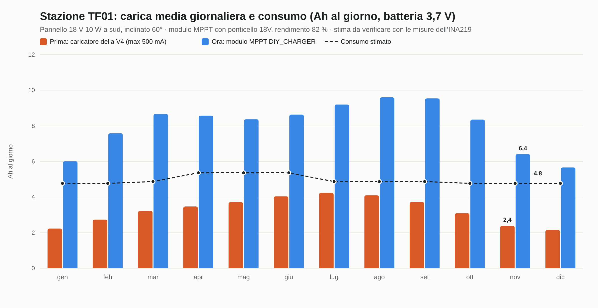

# Bilancio energetico della stazione TF01

Revisione del 4 novembre 2026, con la nuova configurazione di alimentazione:

- **pannello** 18 V 10 W;
- **modulo di carica MPPT** DIY_CHARGER V12.0:
  - ingresso solare 6-24 V, ponticello MPPT su **18V**;
  - Sunlight Detect su **OFF**;
  - uscite 5V/12V e USB-C non usate;
- **batterie** 2 × EVE 18650 in parallelo, sui morsetti BATTERY del modulo;
- **misuratore INA219** (Tenstar) sul + della batteria, letto dalla XIAO via I²C;
- **Heltec V4** alimentata dal suo connettore batteria. Il suo ingresso solare e il convertitore diymore non si usano più;
- **XIAO ESP32-S3 Sense**, alimentata dal pin 3V3 della V4.

Schema dei collegamenti: `schema_collegamenti.png`. I valori sono **stime**: con l'INA219 diventeranno misure (paragrafo 6).

## 1. In sintesi

- **Prima** il collo di bottiglia era il caricatore della V4: 500 mA al massimo, cioè circa 16 Wh al giorno nelle batterie anche col sole pieno. Il bilancio era **in perdita in tutti i mesi**.
- **Ora** il modulo MPPT carica fino a circa 2,4 A e sfrutta tutto il pannello. Il bilancio è **in attivo tutto l'anno**:
  - novembre circa **+1,6 Ah** al giorno di media;
  - dicembre, il mese peggiore, circa **+0,9 Ah**.
- **Il punto debole restano i giorni coperti di fila d'inverno.** Con 2 batterie la stazione regge circa **2-2,5 giorni coperti consecutivi**. Basta una giornata di sole per ricaricarle quasi del tutto.
- **Per stare tranquilli d'inverno:** 4 batterie invece di 2, cioè circa 5 giorni coperti di fila (paragrafo 7).

## 2. Consumi stimati

| Utenza | Corrente | Ore al giorno (novembre) | Ah al giorno |
|---|---|---|---|
| Heltec V4, ricezione LoRa + Bluetooth | ~120 mA | 24 | 2,88 |
| Heltec V4, trasmissioni (H e D, info nodo, telemetria) | picchi ~750 mA | ~2 minuti in tutto | ~0,03 |
| XIAO in ascolto + TinyML + microSD | ~100 mA | 18 | 1,80 |
| XIAO spenta di notte (23-5) + microfono e BME280 | ~2 mA | 6 | 0,01 |
| INA219 | ~1 mA | 24 | 0,02 |
| Modulo MPPT a vuoto (dato non dichiarato) | 1 mA (stima) / 20 mA (caso peggiore) | 24 | 0,02 / 0,48 |
| **Totale** | | | **≈ 4,8 Ah (≈ 17,6 Wh)**; caso peggiore ≈ 5,2 Ah |

Da aprile a giugno la XIAO resta sempre accesa, quindi il totale sale a circa 5,4 Ah al giorno.

Da dove vengono i valori:
- **V4:** ~120 mA misurati sulla V4.3 con amplificatore attivo, in una prova di firmware mesh pubblicata da IoTThinks (EasySkyMesh). Il datasheet Heltec indica 75 mA in sola ricezione e 750 mA in trasmissione a 27 dBm.
- **XIAO:** a riposo circa 70 mA (stessa fonte), più un margine per il calcolo continuo.

La V4 si alimenta dalla batteria e non dall'uscita 5 V del modulo. Passare dai 5 V costerebbe circa il 40 % di energia in più: prima il modulo alza la tensione a 5 V, poi la V4 la riabbassa a 3,3 V.

## 3. Batterie

- **Capacità:** 2 × EVE 18650 da 3000 mAh (ipotesi, da verificare sul modello) = 6 Ah nominali, circa **5,1 Ah utilizzabili**.
- **Autonomia senza nessuna carica:** circa **26 ore**.
- **Protezione dalla scarica profonda:** la protezione del modulo vale solo per le sue uscite, che non usiamo. Ci pensa quindi la XIAO, leggendo l'INA219 (paragrafo 6).

## 4. Il sole di oggi, 4 novembre 2026

Pannello rivolto a sud e inclinato a 60°. Il cielo sereno è calcolato col modello ASHRAE; la giornata coperta vale il 25 % di una serena. Rendimento del modulo: 82 % (intervallo 77-88 %).

| Oggi | Energia dal pannello | Caricati in batteria | Bilancio (consumo 4,8 Ah) |
|---|---|---|---|
| Cielo sereno | ~54 Wh | ~12,0 Ah (11,2-12,8) | **+7,2 Ah**: basta a ricaricare le batterie anche da vuote |
| **Coperto, come oggi** (previsione: nuvoloso, pioggia al 35 %) | ~13 Wh | ~3,0 Ah (2,8-3,2) | **−1,8 Ah**: circa un terzo della batteria utile |

Prima, con il caricatore della V4, gli stessi due giorni davano −0,4 Ah e −3,6 Ah.

## 5. Medie mensili (pannello a 60°, rendimento 82 %)

| Mese | Consumo (Ah/g) | Carica (Ah/g) | Bilancio | Bilancio caso peggiore* | Giorni coperti di fila sostenibili | Giorni di sole per ricaricare da vuote |
|---|---|---|---|---|---|---|
| gen | 4,8 | 6,0 | +1,2 | +0,4 | 2,5 | 0,8 |
| feb | 4,8 | 7,6 | +2,8 | +1,9 | 3,2 | 0,6 |
| mar | 4,9 | 8,7 | +3,8 | +2,8 | 3,3 | 0,6 |
| apr | 5,4 | 8,6 | +3,2 | +2,2 | 2,3 | 0,7 |
| mag | 5,4 | 8,4 | +3,0 | +2,1 | 2,1 | 0,8 |
| giu | 5,4 | 8,6 | +3,3 | +2,3 | 2,0 | 0,9 |
| lug | 4,9 | 9,2 | +4,3 | +3,3 | 2,5 | 0,8 |
| ago | 4,9 | 9,6 | +4,7 | +3,7 | 2,7 | 0,7 |
| set | 4,9 | 9,5 | +4,7 | +3,6 | 3,1 | 0,6 |
| ott | 4,8 | 8,4 | +3,6 | +2,6 | 3,2 | 0,6 |
| nov | 4,8 | 6,4 | +1,6 | +0,8 | 2,6 | 0,8 |
| dic | 4,8 | 5,7 | +0,9 | +0,1 | 2,3 | 0,9 |

\* Caso peggiore: rendimento del modulo 77 % e 20 mA di consumo a vuoto.

**Come sono calcolate le medie.** Mescolano giornate serene e coperte, con un rapporto stimato per il litorale laziale: circa 55 % del cielo sereno a dicembre, circa 80 % a luglio. È una stima climatologica e va controllata con PVGIS (re.jrc.ec.europa.eu/pvgis) inserendo le coordinate della stazione.

**Perché d'estate i giorni coperti sostenibili sono meno.** Da aprile a giugno la XIAO ascolta anche di notte e consuma di più. I periodi coperti lunghi però sono rari in quei mesi.

## 6. Cosa fa l'INA219

L'INA219 sta in serie sul + della batteria: da un lato le batterie, dall'altro il punto dove si uniscono l'uscita BATTERY del modulo MPPT e il connettore batteria della V4. Misura:

- **la tensione della batteria;**
- **la corrente netta**, positiva quando la batteria si carica e negativa quando si scarica. Il modulo Tenstar ha uno shunt da 0,1 Ω e legge fino a ±3,2 A: basta per i circa 2 A massimi di carica.

La XIAO lo legge ogni minuto e:
1. somma la corrente nel tempo e ricava il **bilancio vero** di ogni giornata: Ah entrati, Ah usciti, carica minima e massima;
2. mette tensione e percentuale reali nei campi `batteria%` e `batteria_mV` dei messaggi `BS1 H` e `BS1 D`, che finiscono nella pagina Statistiche del sito;
3. **protegge le batterie:**
   - sotto **3,45 V** smette di ascoltare e va in sonno profondo, svegliandosi ogni ora per ricontrollare;
   - riprende sopra **3,70 V**;
   - sotto **3,30 V** manda un ultimo `BS1 H` di allarme. Anche Meshtastic spegne la V4 quando la batteria è molto bassa.

**Nota sulla carica.** Durante la carica forte, a 2 A, lo shunt toglie circa 0,2 V alla batteria. Il modulo vede quindi 4,2 V e la batteria un po' meno: la carica finisce un po' più lentamente, ma non c'è nessun rischio.

## 7. Cosa fare

**Prova generale:**
- montare il modulo MPPT con il ponticello su 18V;
- partire con le batterie cariche;
- lasciar registrare all'INA219 almeno una settimana. Con quei numeri si sostituiscono le stime di questo documento.

**Da valutare dopo le misure:**
1. **4 batterie 18650 invece di 2**, per circa 10 Ah utilizzabili: circa **5 giorni coperti di fila** a novembre e dicembre. È la modifica più utile per l'inverno.
2. **Ridurre i consumi della V4:**
   - Bluetooth spento sul campo, finiti i test: circa 10-30 mA in meno;
   - schermo OLED che si spegne dopo pochi secondi.
3. **XIAO a 160 MHz** invece di 240, se il riconoscimento ci sta nei tempi.
4. **Pannello inclinato a 60°** rivolto a sud: d'inverno rende di più ed è più pulito.
